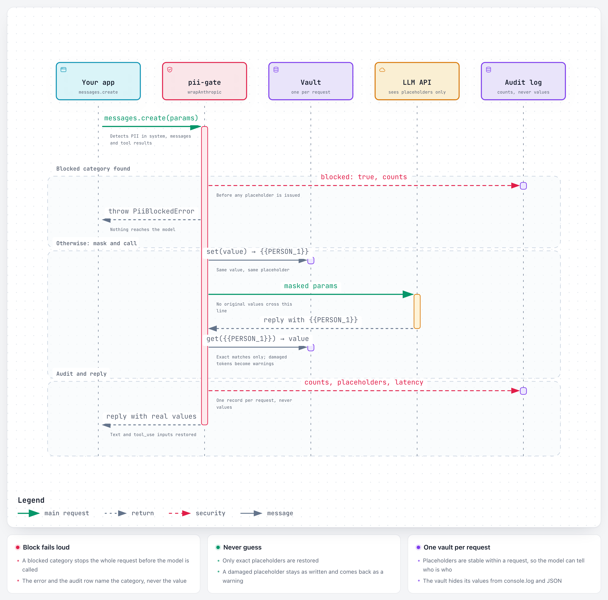

# pii-gate

A small TypeScript library that sits between your application and an LLM API. It finds personal data in outgoing prompts, swaps it for typed placeholders (`{{PERSON_1}}`, `{{SSN_1}}`), sends the masked request, then puts the original values back into the model's reply and tool calls. Insurance work is full of exactly this data. Claims notes, policy emails and client records carry names, SSNs, VINs, dates of birth and addresses. Most useful LLM tasks on that text (summarising a loss, drafting a renewal letter, routing a FNOL) don't need the actual values. pii-gate lets you use a hosted model on that text while keeping the identifiers in your own process. It also writes an audit trail of what was masked, and it never records the values themselves.

**Live demo:** [pii-gate-eight.vercel.app](https://pii-gate-eight.vercel.app). Run a fictional claim note through the gate and see what the model receives, what it replies and what comes back.

The core has zero runtime dependencies. The Anthropic wrapper is typed structurally, so `@anthropic-ai/sdk` is an optional peer.

## Quickstart

```bash
npm install pii-gate
```

```ts
import { mask, unmask } from "pii-gate";

const { masked, vault } = mask(
  "Insured: Maria Gonzalez, DOB: 03/14/1979. Called from (512) 555-0198.",
);
// "Insured: {{PERSON_1}}, DOB: {{DOB_1}}. Called from {{PHONE_1}}."

const reply = await callYourModel(masked); // "Draft a callback to {{PERSON_1}} at {{PHONE_1}}."
const { text, warnings } = unmask(reply, vault);
// "Draft a callback to Maria Gonzalez at (512) 555-0198."
```

With the Anthropic SDK:

```ts
import Anthropic from "@anthropic-ai/sdk";
import type { Message, MessageCreateParamsNonStreaming } from "@anthropic-ai/sdk/resources/messages";
import { JsonlAuditLogger, wrapAnthropic } from "pii-gate";

const client = wrapAnthropic<MessageCreateParamsNonStreaming, Message>(new Anthropic(), {
  policy: { SSN: "block", CREDIT_CARD: "block" },
  audit: new JsonlAuditLogger("./logs/pii-audit.jsonl"),
});

const message = await client.messages.create({
  model: "claude-opus-5-5",
  max_tokens: 1024,
  messages: [{ role: "user", content: `Summarize this claim note:\n${note}` }],
});
// Text blocks and tool_use inputs come back with original values restored.
```

Run `npm run example` to see the whole flow against a fake client.

In the browser or an edge runtime, import from `pii-gate/core`. It has everything above except the file-based `JsonlAuditLogger` and `MemoryAuditLogger`, and uses no Node built-ins.

`demo/` is a Next.js page that runs a fictional claims note through the whole flow: detected values, the masked prompt, the model's reply, the restored reply and the audit row. See `demo/README.md`.

## How it works

<picture>
  <source media="(prefers-color-scheme: dark)" srcset="docs/diagrams/request-flow-dark.png">
  
</picture>

An [interactive version](https://pii-gate-eight.vercel.app/diagrams/request-flow.html) links each participant to its source. The diagram is generated with [Archify](https://github.com/tt-a1i/archify) from [`docs/diagrams/request-flow.archify.json`](docs/diagrams/request-flow.archify.json). Archify is MIT-licensed; see [THIRD_PARTY_NOTICES.md](THIRD_PARTY_NOTICES.md).

- **Detection** comes from regex detectors for SSN, phone, email, VIN (with check digit), credit card (Luhn), DOB (cue-gated), driver's license (cue-gated), street address and person name (cue-gated). US formats are detected anywhere in the text. International phone numbers (`Phone: +44 20 7946 0958`, `phone number: 55501234`) and day-first dates of birth (`DOB: 15/02/1988`) are detected only directly after a label. When matches overlap, the longest wins, and ties go to the higher confidence. Numbers labelled as policy, claim or account identifiers are not reported as phones or SSNs.
- **Schema hints** handle values you already know from the database record, which are masked directly without detection: `schemaHints: { insured: { value: row.insured_name, category: "PERSON" } }`. They take priority over detector output, and their categories can be custom (`CLAIM_ID`, `MEMBER_ID`).
- **Propagation** works like this: once a name is found through a cue ("Claimant: Tomasz Kowalski"), its other occurrences in the same request get masked too ("Kowalski's home", "tomasz kowalski"). The full name matches in any case; a single part ("Kowalski") matches only as written, so "Claimant: Sarah May" doesn't mask "the adjuster may call". A part reuses the full name's placeholder ("Kowalski prefers email" → "{{PERSON_1}} prefers email"), so the model sees one person, and unmasking restores the full name there. If two detected names share the part ("Dana Whitfield", "Sam Whitfield"), the bare "Whitfield" is ambiguous and gets a placeholder of its own rather than a guess. The wrapper applies this across the system prompt, every message and every tool result.
- **The vault** holds token ↔ value for one request. The same value always gets the same token, so the model can reason that two mentions refer to one person.
- **Unmasking** is exact-match only. If the model mangles a token (`{person_1}}`, `[[SSN_1]]`, `SSN_1`), the text is left as written and a warning with a suggested token is returned. A wrong restore could put one customer's data into another customer's letter, so a visible placeholder is the safer failure.
- **Audit records** hold the request id, timestamp, model, per-category counts, the blocked flag, the number of placeholders in the response, the unmask warning count and the latency. They never contain values, prompt text or upstream error messages.

Every call through `wrapAnthropic` writes exactly one audit record, including calls rejected before they reach the model. A policy block is recorded as `blocked: true`, with the triggering categories in `blockedCategories`. Other rejections (a streaming request, unsupported content such as an image, an invalid category from a schema hint or custom detector) and upstream API failures are recorded with `error` set to the error's class name only, never its message, because messages can echo input. If the audit logger itself throws while a request is failing, the original error is rethrown and the audit failure is dropped, so `instanceof` checks on the caller's side still work. On a successful request, an audit failure is passed on to the caller.

### Plugging in other detectors

```ts
import { defaultDetectors, mask, staticDetector, type Detector } from "pii-gate";

const memberIds: Detector = {
  name: "member-id",
  categories: ["MEMBER_ID"],
  detect: (text) => [...text.matchAll(/\bGH-\d{8}\b/g)].map((m) => ({
    category: "MEMBER_ID", start: m.index, end: m.index + m[0].length, value: m[0], confidence: 0.9,
  })),
};

// Async NER: run it first, then feed its spans in.
const nerSpans = await myNer(text);
mask(text, { detectors: [...defaultDetectors(), memberIds, staticDetector("ner", nerSpans)] });
```

## Policy model

Each category gets one action. Categories you don't list use `defaultAction`, which defaults to `"mask"`.

| Action  | Effect | Typical use |
|---------|--------|-------------|
| `mask`  | Replace with a placeholder and restore it in the response. | Names, phones, emails, addresses, VINs: the model needs to know *that* there is a person or vehicle, not *which* one. |
| `block` | Throw `PiiBlockedError` before anything is sent or tokenised. The error lists categories and counts only. | SSNs, card numbers. No prompt needs them, and if one shows up it usually means a template or retrieval step is pulling the wrong field. |
| `allow` | Leave the value in place. It is still detected and counted in the audit. | Values the task depends on, such as `DOB` for an age-rating question, or an agency's own phone number. |

See [docs/adr/0001-mask-vs-block-vs-allow.md](docs/adr/0001-mask-vs-block-vs-allow.md) for why there are three actions rather than one.

## Performance

On an Apple M5 Pro (Node 24, built `dist/`), a wrapped `messages.create` on a 2.6 KB request (system + 3 messages + tool_result, reply with 12 placeholders) spends ~0.25 ms p50 / ~0.30 ms p95 in the gate; the fake client it wraps resolves at the timer floor. Masking a ~2 KB claim note alone takes ~0.07 ms. A model call takes hundreds of ms to seconds, so the gate is noise.
Cold start is the exception: measured after module import (which adds a few ms), the first `mask` in a fresh process takes ~15 ms while V8 warms up, so a first wrapped call costs roughly 15 + 2 ms.
Method, variance, a propagation on/off comparison and 300 B / 10 KB scaling: [docs/benchmarks.md](docs/benchmarks.md). Reproduce with `npm run bench`.

## Limitations

- **Regex misses things.** The detectors are tuned for precision. A name with no cue ("spoke with Maria about the claim") is not detected unless it also appears with a cue, or you pass it as a schema hint. Non-US formats are covered only where a label makes them unambiguous: international phone numbers are detected only after a phone label (phone, tel, mobile, cell, contact number, ...), and day-first dates of birth only after a birth cue. An unlabelled international number or day-first date passes through. Other national IDs and non-NANP addresses are not covered. PO boxes, rural routes and addresses that wrap across lines are missed, and the address detector masks the street line only — city, state and ZIP pass through, which is usually acceptable but worth knowing.
- **NER is still needed for free text.** Adjuster notes and emails mention people, employers, medical providers and places without labels. Plug a named-entity model in through the `Detector` interface (or `staticDetector` for async models) and use regex as a deterministic floor. Even then, nothing here guarantees zero leakage. Treat this as one layer next to data minimisation and vendor agreements.
- **Quasi-identifiers pass through.** A loss description ("the only red Tesla on Elm in a town of 400") can identify someone with no PII in it. Detection doesn't address re-identification.
- **No cross-request linkage.** Vaults are per request, so `{{PERSON_1}}` in one call and `{{PERSON_1}}` in the next can be different people. For a multi-turn conversation, either re-send the full history each time (the usual Messages API pattern, and what the wrapper expects) or pass a `createVault` that returns a conversation-scoped vault. In both cases the model never sees a stable identifier across conversations, which is deliberate.
- **Name-part propagation is a heuristic.** Parts of a detected name are masked wherever they appear capitalized, so a surname that is also a street name, or "May"/"Bill" at the start of a sentence, gets over-masked. All-caps (`MAY`) and lowercase variants of a single part are not masked unless the full name matches. Because a part shares the full name's placeholder, unmasking writes the full name where only the part appeared ("Kowalski's home" comes back as "Tomasz Kowalski's home"). `propagateNameParts: false` turns parts off.
- **Restoration is lossy for variants.** Values that differ only in case or whitespace share one token and come back in the first-seen spelling.
- **Content the wrapper can't read is rejected.** Images, PDFs, server-tool blocks and streaming throw `UnsupportedContentError` by default (`unsupportedContent: "passthrough"` overrides this). Thinking blocks pass through unchanged because their signatures forbid edits.
- **Masking doesn't stop exfiltration through tools.** The wrapper restores real values into `tool_use.input`, so a prompt injection in a document or tool result can get the model to call, say, `send_email` with `{{SSN_1}}`, and your handler receives the real SSN. Handlers with external side effects (email, HTTP, file writes) should get placeholders and resolve them on purpose. The wrapper can't do that yet: `create` and `createWithReport` both return the already-unmasked message. Until a per-tool `restoreToolInputs` option lands, call `maskAll` and the client yourself for those flows, and `unmask` only the tool inputs you trust. See [ADR 0002](docs/adr/0002-tool-input-restoration-and-injected-placeholders.md).
- **Placeholders can be prompt-injected.** Placeholder-shaped text already in the input (`{{PERSON_1}}` typed by a user or planted in a document) is not escaped and will be restored, but only to a value from the same request. Escaping exact tokens is planned (ADR 0002). Even then, a mangled form like `{{SSN_1}` can be "fixed" by the model into a real token. Avoid putting values from two customers in one request.

## Development

```bash
npm install
npm test          # vitest
npm run typecheck # strict tsc over src, test, examples, bench
npm run build     # emits dist/
npm run example
npm run bench     # latency benchmark, writes docs/benchmarks.md
```

The golden set in `test/fixtures/` contains insurance-flavoured texts with expected findings per category. All PII in it is fake: 555-01xx phone numbers, UK numbers from Ofcom's drama ranges (020 7946 0xxx, 07700 900xxx), `example.*` domains, test card numbers and synthetic VINs with valid check digits.

## Layout

```
src/
  detectors/   one file per category, plus overlap resolution
  mask.ts      mask, maskAll, schema hints, propagation, policy
  unmask.ts    unmask, unmaskDeep, near-match warnings
  vault.ts     Vault, InMemoryVault, Redis contract
  audit.ts     AuditLogger, JsonlAuditLogger, MemoryAuditLogger
  anthropic.ts wrapAnthropic
  core.ts      browser-safe entry (pii-gate/core)
demo/          Next.js demo page (not part of the package)
```
